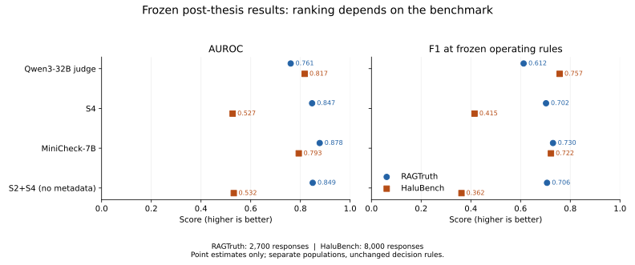
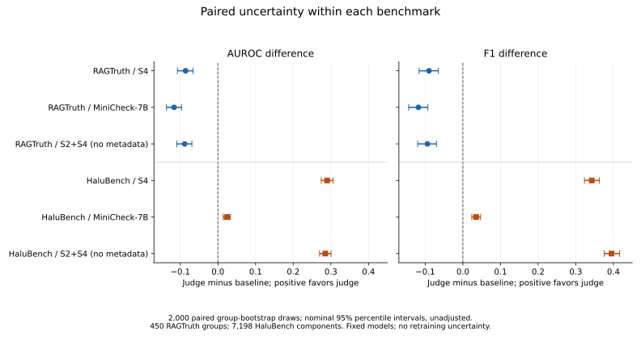

# Frozen post-thesis LLM judge: results overview

Status as of 2026-11-02: both benchmark evaluations, cached replays, the selected
qualitative review and inference accounting are complete. These results were
collected after thesis submission and are excluded from the submitted thesis.
This page consolidates frozen findings; it does not introduce a new experiment.

## Main finding

The frozen Qwen3-32B judge trails all three fresh baselines on RAGTruth AUROC,
average precision and F1. On canonical HaluBench, with the same prompt, calibration
and decision rule, it leads aggregate AUROC and F1. MiniCheck retains higher
HaluBench accuracy and precision, while the judge-minus-MiniCheck average-precision
interval includes zero. This supports a benchmark-dependent ranking reversal for
these particular systems, not a universal advantage for either model family.

| System | RAGTruth AUROC | RAGTruth F1 | HaluBench AUROC | HaluBench F1 |
| --- | ---: | ---: | ---: | ---: |
| Qwen3-32B judge | 0.7609 | 0.6123 | 0.8172 | 0.7572 |
| S4 | 0.8470 | 0.7024 | 0.5272 | 0.4148 |
| MiniCheck-7B | 0.8776 | 0.7304 | 0.7933 | 0.7221 |
| S2+S4 (metadata-free) | 0.8494 | 0.7065 | 0.5319 | 0.3622 |



RAGTruth has 2,700 shared responses in 450 exact-overlap groups; HaluBench has
8,000 shared responses in 7,198 exact-passage bootstrap components. F1 uses each
system's fixed RAGTruth TRAIN/development operating rule. The two populations are
not a paired cross-dataset experiment. Full metrics, including AP, precision,
recall, accuracy, Brier and ECE, remain in the [RAGTruth findings](ragtruth_frozen_evaluation_20260928.md)
and [HaluBench findings](halubench_frozen_evaluation_20260929.md).

## Paired uncertainty



The registered procedure uses 2,000 shared whole-group bootstrap draws within
each benchmark. All plotted intervals are nominal 95% percentile intervals,
unadjusted for multiple comparisons and conditional on the fitted systems.
They do not measure retraining variability or establish significance between
baselines.

Against MiniCheck, the judge's RAGTruth AUROC difference is -0.1166
[-0.1368, -0.0968] and F1 difference is -0.1181 [-0.1440, -0.0930].
On HaluBench these become +0.0239 [+0.0138, +0.0332] and +0.0351
[+0.0237, +0.0469]. The HaluBench AP difference is +0.0061
[-0.0032, +0.0150], so a clear AP improvement over MiniCheck is not established
by that interval. No threshold or prompt was selected from these TEST outcomes.

## HaluBench source variation

| Source | Responses | Judge AUROC | S4 AUROC | MiniCheck AUROC | Fusion AUROC |
| --- | ---: | ---: | ---: | ---: | ---: |
| DROP | 560 | 0.4474 | 0.4668 | 0.5110 | 0.5050 |
| FinanceBench | 573 | 0.6036 | 0.5177 | 0.5766 | 0.5105 |
| covidQA | 559 | 0.8064 | 0.5420 | 0.9157 | 0.5842 |
| halueval | 5,728 | 0.8598 | 0.5383 | 0.8085 | 0.5396 |
| pubmedQA | 580 | 0.8697 | 0.5158 | 0.8479 | 0.5153 |

These are descriptive slices, without source-specific intervals or fitted
thresholds. halueval accounts for 71.6% of HaluBench. Pooled AUROC is not a weighted
average of within-source AUROCs. DROP remains a clear weakness, and MiniCheck has
higher AUROC on covidQA. Aggregate transfer success does not imply robust detection
on every source.

## What was frozen

The answer/context-only judge is `Qwen/Qwen3-32B`, revision
`9216db5781bf21249d130ec9da846c4624c16137`, BF16, non-thinking, one H200,
vLLM 0.29.0, concurrency one. It scores one label token using the primary mapping
A=supported and B=unsupported. Ranking uses unrounded `logP(B) - logP(A)`.

The TRAIN-fitted probability map is
`sigmoid(0.3808096416654668 * margin + 0.3575745057816423)`.
The judge flags unsupported answers at raw margin `>= -1.25`.
S4 uses unsupported probability `>= 0.55`; MiniCheck uses support probability
`< 0.20000000000000004`; metadata-free S2+S4 uses unsupported probability
`>= 0.45`. These choices transfer unchanged to HaluBench.

The exact prompt, model, tokenizer, serving and decision identities are retained
in the [frozen judge configuration](../../../post_thesis/llm_judge/configs/frozen_judge_v1.json)
and [evaluation protocol](../../../post_thesis/llm_judge/EVALUATION_PROTOCOL.md).
The configuration's historical execution-pending status records when the decision
freeze was made; it is not rewritten after execution. Execution plans and result
reports separately establish completion.

## Calibration, evidence and review limitations

- Judge calibration improves aggregate ECE/Brier on both benchmarks, but the
  baselines did not receive equivalent post-hoc calibration. This is not evidence
  of an intrinsic calibration advantage. On RAGTruth, raw metadata-free fusion
  retains lower ECE/Brier than the calibrated judge; source-level calibration
  transfer is not uniformly beneficial.
- Evidence handling and training exposure differ. S4 truncates 1,740 RAGTruth and
  850 HaluBench contexts. S2 retains 1,886 HaluBench empty-pair examples with the
  original zero-feature fallback. This is a practical-system comparison, not an
  architecture-only or matched-evidence ablation.
- Fresh inference establishes current input/score alignment; it does not prove
  historical cache contents or checkpoint training membership. MiniCheck's
  fresh-runtime RAGTruth scores change 100 fixed-threshold decisions relative
  to the legacy cache; the cause remains unresolved.
- Exact-overlap grouping does not prove strict document disjointness. Exact
  passages connect 994 HaluBench TEST rows to adaptation components, but no
  adaptation training is used. Historical thesis benchmark results were already
  known; this extension is not evaluation on previously unseen benchmarks.
- The [127-case qualitative review](qualitative_review_20261102.md) contains
  AI-assisted assessments collectively confirmed by the researcher before key
  access: 28 supported, 58 unsupported and 41 uncertain. Among 86 determinate
  cases, 22 differ from benchmark labels. This is selected-case analysis, not
  independent annotation, corrected labels or a population label-error rate.

## Runtime accounting

The [verified accounting report](efficiency_accounting_20261102.md) separates
successful-request latency from client time and baseline measurement scopes.
Qwen request median/p95 were 133.1/208.0 ms on RAGTruth and 75.9/426.7 ms on
HaluBench. The HaluBench parent and continuation retain 8,001 attempts for 8,000
valid scores, with one interrupted attempt's token usage and latency unknown.
No common timing experiment supports controlled speedup claims. Monetary cost
is unknown because billable duration and rate were not supplied.

## Reproducing and preserving the results

Public figure regeneration requires only the committed aggregate JSON files and
Matplotlib 3.10.8, in a separate plotting environment. From the repository root:

```bash
python -m post_thesis.llm_judge.plot_frozen_results
```

No GPU, server, model weights, raw benchmark inputs or private predictions are
read. The script checks canonical JSON hashes, so line-ending changes on Windows
do not affect validation. It writes only the two SVG figures; it does not recompute
metrics or confidence intervals. The [figure README](../../../figures/post_thesis/llm_judge/README.md)
records dependencies and the distinction between plotting and metric replay.

Full offline verification/replay requires the private PVC artifacts and the
pinned CPU environment described in [RAGTruth evaluation](../../../post_thesis/llm_judge/TEST_EVALUATION.md)
and [HaluBench evaluation](../../../post_thesis/llm_judge/HALUBENCH_EVALUATION.md).
The uploaded full report hashes and public aggregate metrics have been verified
in [the accounting record](efficiency_accounting_20261102.json); raw inference
was not rerun during this documentation step.

Preserve the private input manifests, request/response journals, parent and
continuation records, fit/freeze records, baseline provenance, full evaluations
and review packet/key outside any disposable pod filesystem. Git contains public
aggregates and code, not all material needed for private replay. The release tag
`post-thesis-llm-judge-v1` points to `c1b1cd6`, following passing CI. Subsequent
documentation cleanup does not move that tag or change frozen results. A future
cascade, new prompt or new calibration would be a separate experiment.
